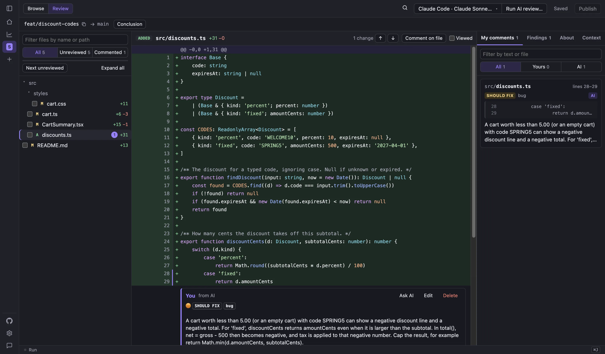
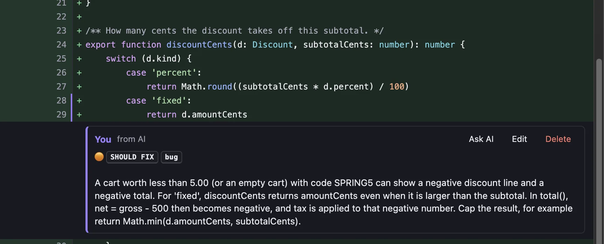
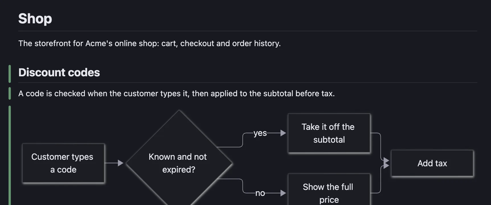
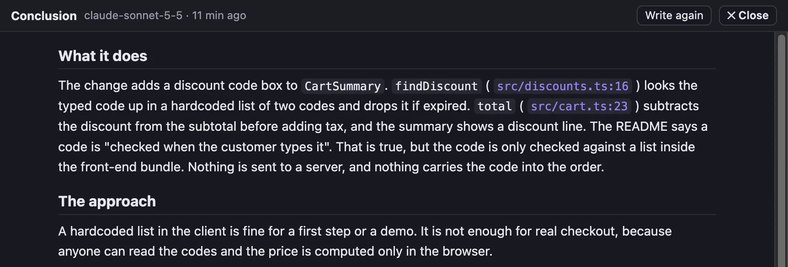
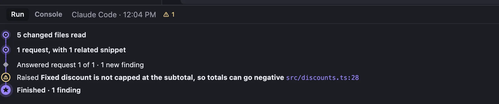

<div align="center">
  
  <h1>Review</h1>
  <p><strong>Code review on your own machine.</strong></p>
  <p>A desktop app for Git branches and GitHub pull requests: comment on any line, publish when you're ready,<br />and add an AI reviewer with your own model, or none.</p>
  <p>
    <a href="https://github.com/hamedghaderi/review/actions/workflows/ci.yml"></a>
    <a href="https://github.com/hamedghaderi/review/releases/latest"></a>
    <a href="https://github.com/hamedghaderi/review/releases"></a>
    
    <a href="LICENSE"></a>
    <a href="https://github.com/sponsors/hamedghaderi"></a>
  </p>
  <p>
    <a href="https://www.producthunt.com/products/review-2/reviews/new?utm_source=badge-product_review&amp;utm_medium=badge&amp;utm_source=badge-review-2">
      <picture>
        <source media="(prefers-color-scheme: dark)" srcset="https://api.producthunt.com/widgets/embed-image/v1/product_review.svg?product_id=1336268&amp;theme=dark" />
        
      </picture>
    </a>
  </p>
  <p>
    <a href="https://review-code.dev/"><strong>Website</strong></a> ·
    <a href="https://github.com/hamedghaderi/review/releases/latest"><strong>Download</strong></a> ·
    <a href="docs/guide.md"><strong>User guide</strong></a>
  </p>
  <br />
  
</div>

## Features

- **Branches and pull requests in one place.** Browse local branches, remotes and GitHub PRs, and press `⌘P` to jump anywhere.
- **Reviews pinned to exact commits.** Each review compares from the merge base, so the diff doesn't move when someone pushes.
- **Comments that stay local.** Nothing goes to GitHub until you publish. Comments land in your pending review, and you submit it.
- **Bring your own AI, or none.** OpenAI, Anthropic, Gemini, OpenRouter, any OpenAI-compatible endpoint, or a local model in Ollama or LM Studio. Keys are encrypted with your system keychain.
- **MCP tools.** AI reviewers can call your MCP servers for context the repository doesn't have, like the ticket behind a change.
- **Findings that are checked, then summed up.** A second pass double-checks blocking findings, and the Conclusion steps back to judge the change as a whole.
- **What's around the PR.** Stacked PRs, commits that landed on the base since it branched, and other open PRs changing the same files.

<table>
  <tr>
    <td width="50%"><br /><sub><b>Findings in the code.</b> Each one is a comment you can ask about, edit or delete before anything is posted.</sub></td>
    <td width="50%"><br /><sub><b>Rendered Markdown.</b> Changed blocks are marked, and Mermaid diagrams are drawn when you ask.</sub></td>
  </tr>
  <tr>
    <td width="50%"><br /><sub><b>A Conclusion on the whole change.</b> What it does, whether the approach fits, and what to fix first.</sub></td>
    <td width="50%"><br /><sub><b>Every run, step by step.</b> What the AI read and found, in the Run drawer (⌘J).</sub></td>
  </tr>
</table>

## Install

Download the installer for your system from the [latest release](https://github.com/hamedghaderi/review/releases/latest). You need Git installed.

On macOS you can also use Homebrew:

```sh
brew install hamedghaderi/tap/review
```

The installers aren't signed yet, so your system asks once on first open. On macOS, go to **System Settings → Privacy & Security** and click **Open Anyway**. On Windows, click **More info → Run anyway**.

## Build from source

Requires Node 22.12+ and Git.

```sh
git clone https://github.com/hamedghaderi/review.git
cd review
npm install
npm run dev
```

| Command             | What it does                                                     |
| ------------------- | ---------------------------------------------------------------- |
| `npm run dev`       | Run with hot reload                                              |
| `npm test`          | Run the tests (temporary repos, mock servers)                    |
| `npm run typecheck` | Type-check main and renderer                                     |
| `npm run format`    | Format with Prettier                                             |
| `npm run dist`      | Build macOS installers (`dist:win`, `dist:linux` for the others) |

## Docs

- [User guide](docs/guide.md): browsing, pull requests, publishing, AI review, MCP servers
- [Architecture](docs/architecture.md): how AI review works, code layout, how reviews are stored
- [Releasing](docs/releasing.md): building installers and publishing a release

## Support

Review is free and MIT licensed. If it saves you time, you can [sponsor it on GitHub](https://github.com/sponsors/hamedghaderi), one-time or monthly.

## Contributing

Issues and pull requests are welcome. Before opening a PR, run `npm test`, `npm run typecheck` and `npm run format:check`; CI runs the same three. Copy that talks about the AI follows [How the AI appears](docs/architecture.md#how-the-ai-appears). To report a security problem, see [SECURITY.md](SECURITY.md).

## License

[MIT](LICENSE)
